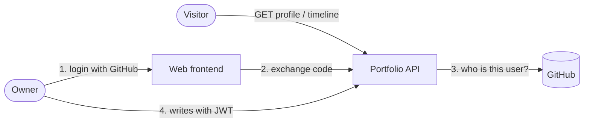
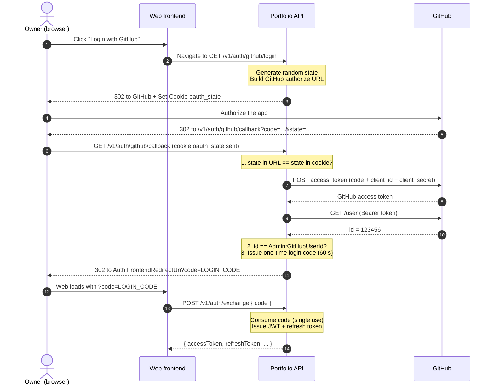
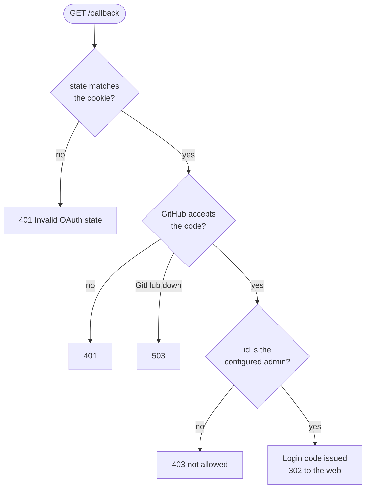
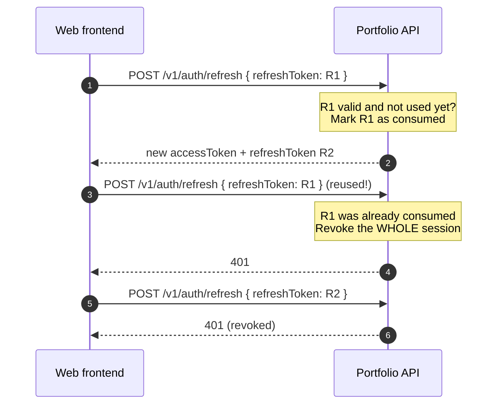
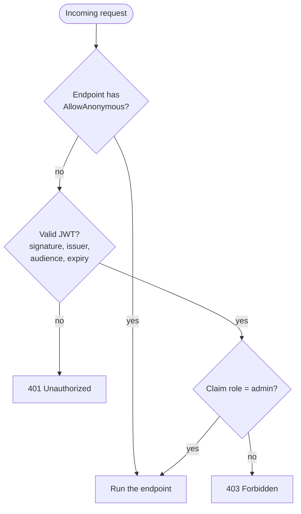
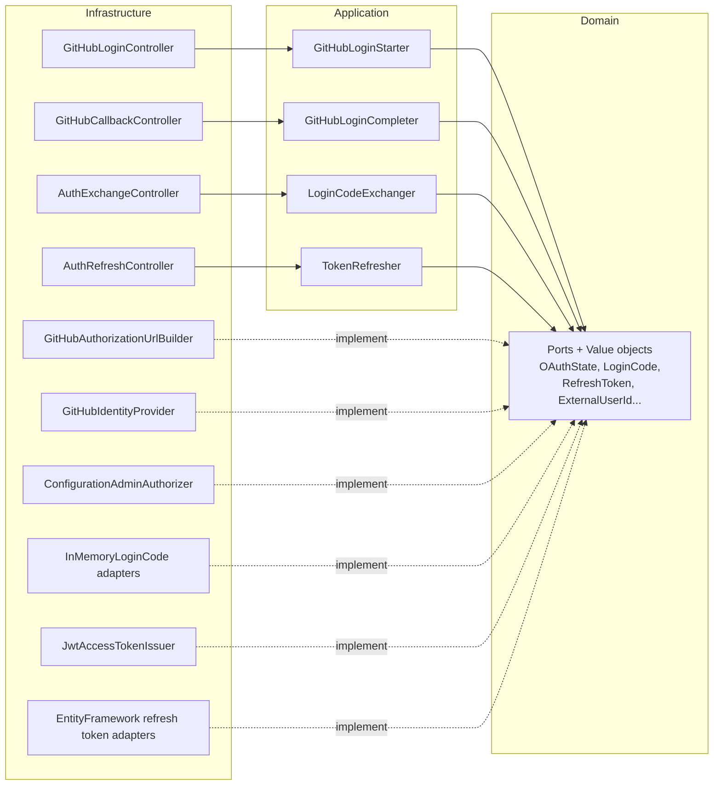

# Authentication & Authorization

How the API decides who you are (authentication) and what you may do (authorization).

The diagrams are written in Mermaid and render on GitHub and in the IDE preview.

---
## 1. The Big Picture

Only **one person** (the owner) can change the portfolio. Everyone else can only read the public data.

- **Login** is delegated to GitHub (OAuth 2.0, Authorization Code flow). The API never sees a GitHub password.
- **Access control** is done by the API with its **own JWT**. GitHub is only used to prove who you are once.
- The owner is recognised by the **immutable numeric GitHub user id**, never by username or email (those can change or be reused).

| Who | What they can do | How |
|---|---|---|
| Visitor | Read the profile and the timeline | No token (`[AllowAnonymous]`) |
| Owner | Everything else (create, update, delete) | `Authorization: Bearer <access token>` |
| Anyone else | Nothing beyond reading | GitHub login succeeds, the API answers 403 |

---
## 2. The Login Flow (step by step)

Five requests, three actors: the browser, the API and GitHub.

### Why each piece exists

| Piece | Problem it solves |
|---|---|
| `state` + `oauth_state` cookie | Prevents login CSRF: only the browser that started the login can finish it. The callback compares the `state` of the URL with the cookie (constant-time comparison) and deletes the cookie. |
| GitHub numeric `id` | Identifies the user without trusting names or emails. |
| `Admin:GitHubUserId` | Decides who is the owner. A valid GitHub user who is not the owner gets **403**. |
| One-time **login code** | The API must hand the web something after the redirect. Putting the real tokens in the URL would leak them (history, logs, `Referer`). The code is useless after 60 seconds or after one use. |
| `POST /v1/auth/exchange` | Turns the code into tokens in the response **body**, not in a URL. |

### Where the failures end up

---
## 3. The Tokens

After the exchange the web holds two tokens.

| Token | Lifetime | Used for | Stored in the API |
|---|---|---|---|
| **Access token** (JWT) | 15 minutes | Sent on every write request | Not stored (it is signed) |
| **Refresh token** | 7 days | Get a new access token without logging in again | Only its SHA-256 hash, in the database |

The access token is signed with `Jwt:SigningKey` (HMAC-SHA256) and carries:

| Claim | Value | Meaning |
|---|---|---|
| `sub` | `Admin:Username` | Who the token belongs to |
| `role` | `admin` | What the authorization policy checks |
| `iss`, `aud`, `exp` | from settings / now + 15 min | Validated on every request |

### Refresh with rotation

Each refresh token is **single use**. Using it returns a new pair and invalidates the old one.

If a refresh token is used twice, someone probably copied it. The API deletes every refresh token of that owner, which forces a new login.

---
## 4. Authorization (who may call what)

- The **`Admin` policy** (`role = admin`) is the **default and the fallback** policy. Any endpoint without an explicit attribute requires the owner. Forgetting to protect a new endpoint is not possible, it is protected by default.
- Public endpoints opt out explicitly with `[AllowAnonymous]`: the profile finder, the timeline finder and the whole `v1/auth/*` family.

---
## 5. Endpoints

| Endpoint | Access | Purpose |
|---|---|---|
| `GET v1/auth/github/login` | Anonymous | Start the login: sets the `oauth_state` cookie and redirects to GitHub |
| `GET v1/auth/github/callback` | Anonymous | GitHub returns here: validates, authorizes the owner, redirects to the web with a login code |
| `POST v1/auth/exchange` | Anonymous | `{ "code": "..." }` returns the access and refresh tokens |
| `POST v1/auth/refresh` | Anonymous | `{ "refreshToken": "..." }` returns a new pair |
| Profile and timeline reads | Anonymous | Public portfolio data |
| Everything else | Owner only | Writes and the rest of the reads |

Browsers must **navigate** to `login` (a link or `window.location`); a `fetch` cannot follow the cross-site redirect nor keep the cookie.

---
## 6. Code Map

Where each concept lives, following the hexagonal layout (`Domain` has no framework dependencies).

| Use case | Ports it uses |
|---|---|
| `GitHubLoginStarter` | `IOAuthStateIssuer`, `IAuthorizationUrlBuilder` |
| `GitHubLoginCompleter` | `IExternalIdentityProvider`, `IAdminAuthorizer`, `ILoginCodeIssuer`, `ILoginCodeSaverRepository` |
| `LoginCodeExchanger` | `ILoginCodeConsumerRepository`, `IAdminUsernameProvider`, `IAccessTokenIssuer`, `IRefreshTokenIssuer`, `IRefreshTokenSaverRepository` |
| `TokenRefresher` | `IRefreshTokenConsumerRepository`, `IAccessTokenIssuer`, `IRefreshTokenIssuer`, `IRefreshTokenSaverRepository` |

Controllers only translate HTTP (cookies, redirects, status codes). The rules (state check, owner check, single use) live in the domain models, ports and use cases.

---
## 7. Configuration

The repository is **public**: no secret is ever committed. `appsettings.json` only holds empty keys and public URLs.

| Setting | Secret? | Purpose |
|---|---|---|
| `Jwt:SigningKey` | **Yes** | Signs the access tokens |
| `Jwt:Issuer`, `Jwt:Audience` | No | Validated on every request |
| `GitHub:ClientId` | No (but environment specific) | Identifies the OAuth App |
| `GitHub:ClientSecret` | **Yes** | Proves the API is the OAuth App when exchanging the GitHub code |
| `GitHub:RedirectUri` | No | The callback URL registered in the OAuth App |
| `GitHub:AuthorizeEndpoint`, `TokenEndpoint`, `UserEndpoint`, `UserAgent` | No | Public GitHub URLs, committed |
| `Auth:FrontendRedirectUri` | No | Where the API sends the browser with `?code=` |
| `Admin:Username` | No | The `sub` claim of the tokens |
| `Admin:GitHubUserId` | **Yes** (do not publish it) | The numeric id of the owner |

Where to put them:

- **Local:** `dotnet user-secrets set "GitHub:ClientSecret" "<value>" --project Portfolio.Api`
- **Production:** environment variables, with `__` as the separator (`GitHub__ClientSecret`).

The `GitHub` and `Auth` settings are validated at startup: the application refuses to start if one is missing.

---
## 8. Known Limitations

- **Login codes live in memory** (60 s). A restart in that window, or a second API instance, invalidates the code and the login must be repeated. Revisit it if the API ever runs on several instances.
- **The database is in memory** (EF InMemory): refresh tokens are lost when the API restarts, so the owner has to log in again.
- **Callback errors are shown as JSON** in the browser instead of redirecting to the web with an error.
- **`Secure` cookie flag** follows `Request.IsHttps`. Behind a reverse proxy that terminates TLS, forwarded headers must be configured.
- **No logout / token revocation endpoint** yet, and no rate limiting on the auth endpoints.
- **`Admin:GitHubUserId` is not validated at startup**: when empty, nobody can log in.
