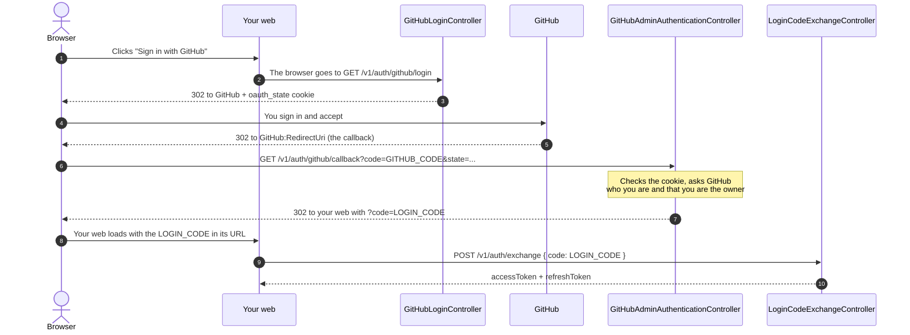

# Authentication & Authorization

How the API decides who you are (authentication) and what you may do (authorization).

---
## 0. How This Kind of Authentication Works

This API does not store passwords. It delegates the login to an external provider using the **OAuth 2.0** standard (*Authorization Code* flow), the same mechanism behind the "Sign in with Google" or "Sign in with GitHub" buttons.

At a high level, it is always the same four steps:

1. **Redirect:** the application sends the user to the provider (here, **GitHub**).
2. **Identification:** the user signs in and accepts *on the provider's site*. The application never sees their password.
3. **Return with a code:** the provider sends the user back to the application with a temporary code.
4. **Verification:** the application, on its server and with its `client_secret`, exchanges that code for the identity of the user.

Here **GitHub** is the provider. GitHub only tells us *who* the user is (their numeric id); **the API decides whether that user is the owner** and, if so, issues its **own JWT** to authorize the following requests.

---
## 1. Overview

Only **one person** (the owner) can modify the portfolio. Everyone else can only read the public data.

- **The login** is delegated to GitHub (OAuth 2.0). The API never sees your GitHub password.
- **Access control** is done by the API with its **own JWT**. GitHub is used only once, to prove who you are.
- The owner is recognised by the **immutable numeric GitHub id**, not by username or email.

| Who | What they can do | How |
|---|---|---|
| Visitor | Read the profile and the timeline | No token (`[AllowAnonymous]`) |
| Owner | Everything else (create, update, delete) | `Authorization: Bearer <access token>` |
| Another GitHub user | Read only | The login works, but the API answers 403 |

---
## 2. The Four Controllers and Why Each One Exists

A login with GitHub does not fit in a single request: the user has to go to GitHub, come back, and then the web has to pick up the token. That is why there is **one controller for each leg of the trip**.

### What Each Controller Does

- **`GitHubLoginController`** (`GET v1/auth/github/login`): the entry door. It generates a random value (`state`), stores it in a cookie and redirects the browser to GitHub. It does not return any URL to your web: the browser follows the redirect on its own.
- **`GitHubAdminAuthenticationController`** (`GET v1/auth/github/callback`): the address where GitHub sends the user back after accepting. It checks the cookie, asks GitHub who the user is and verifies that they are the owner. If everything is fine, it redirects to your web with a one-time code (`LoginCode`). The code that GitHub brings dies here.
- **`LoginCodeExchangeController`** (`POST v1/auth/exchange`): the web sends it the `LoginCode` and receives the `accessToken` and the `refreshToken`. It exists so that the tokens travel in the body of a response and not in a URL.
- **`AuthRefreshController`** (`POST v1/auth/refresh`): when the access token expires, the web sends the `refreshToken` and receives a new pair, without going through GitHub again.

Your web only makes two calls: it navigates to `login` at the beginning and calls `exchange` at the end. What happens in between are browser redirects.

### The Two Codes

The URL carries a `code` parameter at two different moments. They are not the same thing:

| | GitHub code (`AuthorizationCode`) | Our code (`LoginCode`) |
|---|---|---|
| Who creates it | GitHub | Our API |
| Where it arrives | At the callback | At your web, and from there at `exchange` |
| Where it dies | At the callback | At `exchange` (single use, 60 s) |

---
## 3. Refresh Tokens

The access token is a short-lived JWT and nothing is stored about it. The refresh token is the opposite: it lives for days, so the API stores it and can reject it or revoke it.

### What Is Stored

Only the **SHA-256 hash** of the refresh token is stored, never the token itself, together with its owner, its expiration and the moment it was consumed. The token is random and long, so a plain hash is enough: nobody can guess it from the table.

### Rotation: One Token, One Use

Every refresh **consumes** the token it receives and returns a new one. The rules live in the domain model `StoredRefreshToken`, not in the database adapter:

| The token that arrives | Result |
|---|---|
| Unknown | 401 |
| Valid and unused | It is consumed and a new pair is issued |
| Expired | 401 (the session is kept) |
| Already consumed | 401 and **the whole session is revoked** |

An already consumed token that comes back means that someone has a copy of it: either the owner or an attacker is using an old token. The API cannot tell which one, so it removes every refresh token of the owner and forces a new login.

### Two Requests at the Same Time

Two refreshes with the same token can arrive together. The database decides who goes first: `ConsumedAt` is a **concurrency token**, so the update only succeeds if the token was still unconsumed when it was read. The loser is treated as a reuse, with the same consequences.

### Cleaning the Table

There is no background job, because the app may be asleep. Every login and every refresh removes the expired tokens right after saving the new one. Consumed tokens that have not expired are kept, since reuse detection needs them. The cleaning is best effort: if it fails, the login or the refresh still succeeds.

---
## 4. Configuration

The repository is **public**: `appsettings.json` only has empty keys and public URLs. The values are never committed.

| Setting | Secret? |
|---|---|
| `Jwt:SigningKey`, `GitHub:ClientSecret`, `Admin:GitHubUserId` | **Yes** |
| `GitHub:ClientId`, `GitHub:RedirectUri`, `Auth:FrontendRedirectUri`, `Admin:Username`, `Jwt:Issuer`, `Jwt:Audience` | No, but they depend on the environment |
| `GitHub:AuthorizeEndpoint`, `TokenEndpoint`, `UserEndpoint`, `UserAgent` | No, they are public URLs and are committed |

- **Locally:** `dotnet user-secrets set "GitHub:ClientSecret" "<value>" --project Portfolio.Api`
- **In production:** environment variables with `__` as separator (`GitHub__ClientSecret`).
- The `GitHub` and `Auth` settings are validated at startup: the API does not start without them.
- `GitHub:RedirectUri` must be exactly the callback address registered in the GitHub OAuth App.
