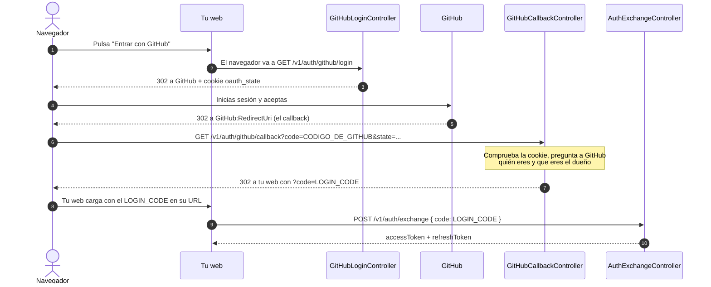

# Autenticación y autorización

Cómo decide la API quién eres (autenticación) y qué puedes hacer (autorización).

---
## 0. Cómo funciona este tipo de autenticación

Esta API no guarda contraseñas. Delega el login en un proveedor externo con el estándar **OAuth 2.0** (flujo *Authorization Code*), el mismo mecanismo de los botones "Entrar con Google" o "Entrar con GitHub".

A alto nivel, siempre son los mismos cuatro pasos:

1. **Redirección:** la aplicación manda al usuario al proveedor (aquí, **GitHub**).
2. **Identificación:** el usuario inicia sesión y acepta *en el sitio del proveedor*. La aplicación nunca ve su contraseña.
3. **Vuelta con un código:** el proveedor devuelve al usuario a la aplicación con un código temporal.
4. **Verificación:** la aplicación, en su servidor y con su `client_secret`, cambia ese código por la identidad del usuario.

Aquí usamos **GitHub** como proveedor. GitHub solo nos dice *quién es* el usuario (su id numérico); **la API decide si ese usuario es el dueño** y, si lo es, emite su **propio JWT** para autorizar las peticiones siguientes.

---
## 1. Visión general

Solo **una persona** (el dueño) puede modificar el portfolio. Los demás solo leen los datos públicos.

- **El login** se delega en GitHub (OAuth 2.0). La API nunca ve tu contraseña de GitHub.
- **El control de acceso** lo hace la API con su **propio JWT**. GitHub se usa una sola vez, para demostrar quién eres.
- El dueño se reconoce por el **id numérico e inmutable de GitHub**, no por el nombre ni el email.

| Quién | Qué puede hacer | Cómo |
|---|---|---|
| Visitante | Leer el perfil y el timeline | Sin token (`[AllowAnonymous]`) |
| Dueño | Todo lo demás (crear, actualizar, borrar) | `Authorization: Bearer <access token>` |
| Otro usuario de GitHub | Solo leer | El login funciona, pero la API responde 403 |

---
## 2. Los cuatro controladores y por qué existe cada uno

Un login con GitHub no cabe en una sola petición: el usuario tiene que ir a GitHub, volver, y después la web tiene que recoger el token. Por eso hay **un controlador por cada tramo del viaje**.

### Qué hace cada controlador

- **`GitHubLoginController`** (`GET v1/auth/github/login`): es la puerta de entrada. Genera un valor aleatorio (`state`), lo guarda en una cookie y redirige el navegador a GitHub. No devuelve ninguna URL a tu web: la redirección la sigue el navegador solo.
- **`GitHubCallbackController`** (`GET v1/auth/github/callback`): es la dirección a la que GitHub devuelve al usuario cuando acepta. Comprueba la cookie, pregunta a GitHub quién es y verifica que es el dueño. Si todo va bien, redirige a tu web con un código de un solo uso (`LoginCode`). El código que trae GitHub muere aquí.
- **`AuthExchangeController`** (`POST v1/auth/exchange`): la web le envía el `LoginCode` y recibe el `accessToken` y el `refreshToken`. Existe para que los tokens viajen en el cuerpo de una respuesta y no en una URL.
- **`AuthRefreshController`** (`POST v1/auth/refresh`): cuando el access token caduca, la web envía el `refreshToken` y recibe un par nuevo, sin volver a pasar por GitHub.

Tu web solo hace dos llamadas: navegar a `login` al principio y llamar a `exchange` al final. Lo que ocurre entre medias son redirecciones del navegador.

### Los dos códigos

La URL lleva un parámetro `code` en dos momentos distintos. No son lo mismo:

| | Código de GitHub (`AuthorizationCode`) | Código nuestro (`LoginCode`) |
|---|---|---|
| Quién lo crea | GitHub | Nuestra API |
| A dónde llega | Al callback | A tu web, y de ahí a `exchange` |
| Dónde muere | En el callback | En `exchange` (un solo uso, 60 s) |

---
## 3. Configuración

El repositorio es **público**: `appsettings.json` solo tiene claves vacías y URLs públicas. Los valores nunca se suben.

| Setting | ¿Secreto? |
|---|---|
| `Jwt:SigningKey`, `GitHub:ClientSecret`, `Admin:GitHubUserId` | **Sí** |
| `GitHub:ClientId`, `GitHub:RedirectUri`, `Auth:FrontendRedirectUri`, `Admin:Username`, `Jwt:Issuer`, `Jwt:Audience` | No, pero dependen del entorno |
| `GitHub:AuthorizeEndpoint`, `TokenEndpoint`, `UserEndpoint`, `UserAgent` | No, son URLs públicas y se suben |

- **En local:** `dotnet user-secrets set "GitHub:ClientSecret" "<valor>" --project Portfolio.Api`
- **En producción:** variables de entorno con `__` como separador (`GitHub__ClientSecret`).
- Los settings de `GitHub` y `Auth` se validan al arrancar: sin ellos la API no arranca.
- `GitHub:RedirectUri` debe ser exactamente la dirección del callback registrada en la OAuth App de GitHub.
